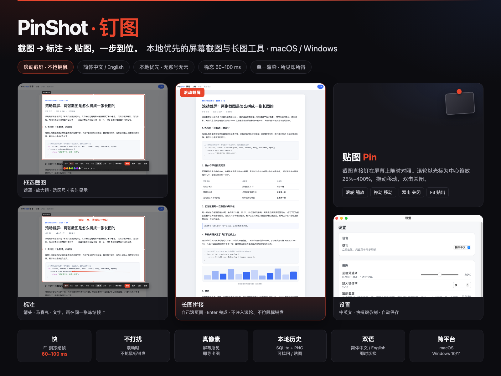
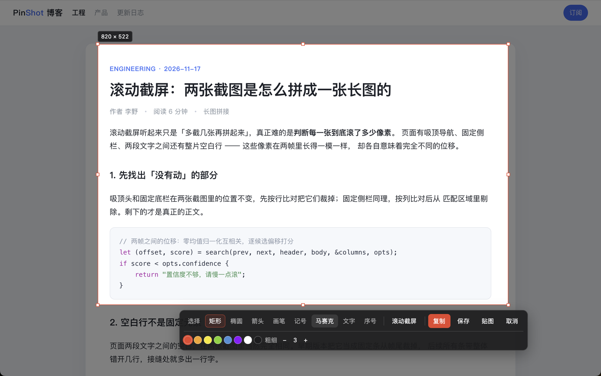
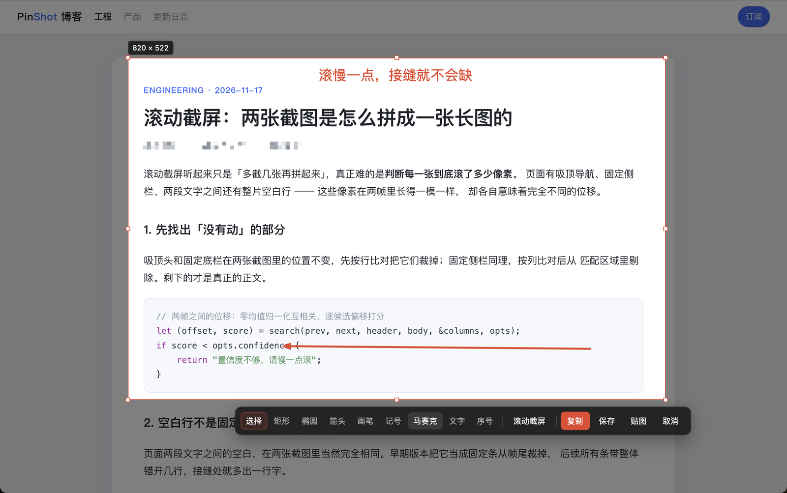
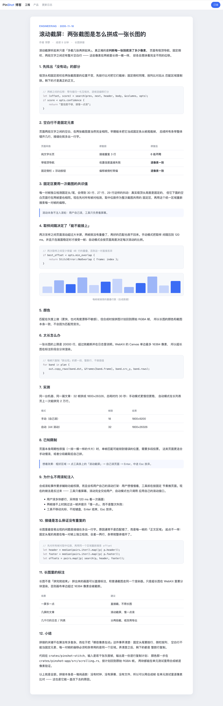
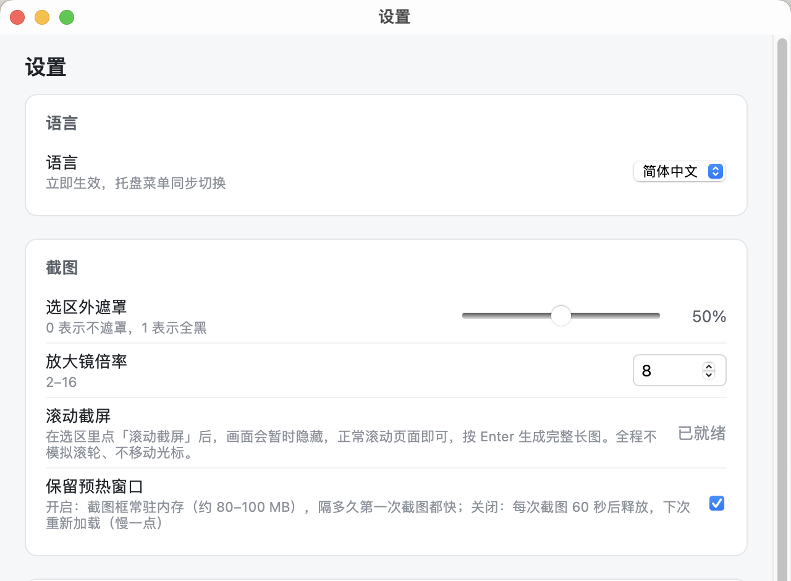

# PinShot · 钉图

**截图 → 标注 → 贴图，一步到位。** 一个本地优先的截图工具（macOS / Windows）：按 F1 出框，画完直接贴到屏幕上，或者复制、存盘、找回历史。

界面支持**简体中文 / English**，在「设置 → 语言」里切换。

快捷键：`F1` 截图 · `Enter` 复制 · `⌘S` 存盘 · `Esc` 取消 · `F3` 贴图 · 工具 `R O A P H M T N`、`V` 选择 —— 完整列表见[常用操作](#常用操作)。



## 为什么用它

- **滚动截屏是一等公民**：框好区域 → 点「滚动截屏」→ 自己滚页面 → Enter 出长图。不模拟滚轮、不抢鼠标键盘，滚多快都行，慢一点更完整。
- **贴图（Pin）**：截图直接钉在屏幕上，随时对照；**滚轮**放大/缩小（25%–400%，以光标为中心），拖动移动，双击关闭。
- **标注只有一套渲染**：屏幕上看到的就是导出图里的，文字、箭头、马赛克都是最终像素。
- **本地优先**：历史存在本机 SQLite + PNG 文件里，没有账号、没有云。
- **快**：按下 F1 到冻结帧铺满屏幕，稳态 **60–100 ms**（2880×1800 Retina 实测）；长时间闲置后第一次约 **300 ms**。

## 功能一览

**框选截图**：遮罩、选区尺寸与工具条。



**标注**：箭头、马赛克、文字都画在同一张冻结帧上——屏幕所见即导出图。



**滚动截屏**：框好区域 → 点「滚动截屏」→ 自己滚页面 → `Enter`。不注入滚轮、不抢鼠标键盘；两帧接不上时会提示慢一点，而不是悄悄留缺口。下面这张原图 2352×7424：



**贴图**：截图钉在屏幕上，滚轮以光标为中心缩放 25%–400%，拖动移动、双击关闭。

**设置**：中英文、快捷键录制、遮罩、放大镜、开机启动等，改完立即生效。



## 安装

**macOS**

1. 下载对应芯片的 DMG 拖进「应用程序」（Apple Silicon 用 `arm64`，Intel 用 `x86_64`），或直接 `pnpm tauri build` 后运行 `scripts/install.sh`。
2. 首次截图会请求 **屏幕录制** 权限：系统设置 → 隐私与安全性 → 屏幕录制 → 勾选 PinShot → 重启应用。
3. 「辅助功能」权限只在需要**读取滚动位置**（让长图拼接更准）时才会被问到，不给也能用。

**Windows**

> ⚠️ **先看这里**：[`docs/PinShot-Windows-0.1.0/`](docs/PinShot-Windows-0.1.0/) 里提供的
> `PinShot_0.1.0_x64-setup.exe` 和 `PinShot.exe` 是 **2026-11-13/14 的旧构建**，
> **不是当前最新代码**——不含此后源码的修复与新功能（如滚动截屏的 Windows 操作提示、
> 导出性能优化、滚动截屏回车回归修复等）。这个包由 macOS 交叉编译产出，Windows 实机只做过
> 基础验证，**没有针对最新代码做过真机详细测试**。
>
> **建议：在 Windows 上用当前源码自己打包**（见下方[从源码构建](#从源码构建)），这样才是最新代码。
> 本机的 macOS 环境无法完整交叉编译验证 Windows 版，实际运行效果请在 Windows 真机自测。

1. 若只用旧包：运行 `PinShot_0.1.0_x64-setup.exe`（装到 `%LOCALAPPDATA%\PinShot`），或用免安装的 `PinShot.exe`。
2. 需要 Windows 10/11 x64 + WebView2（Win11 自带，Win10 一般已随 Edge 安装）。
3. 程序未签名，SmartScreen 提示「未知发布者」时选「仍要运行」。
4. 已经运行时再启动一次不会多开：会切到已经在跑的实例并打开「设置」。

## 常用操作

| 场景 | 操作 |
| --- | --- |
| 截图 | 托盘菜单「截图」或按 `F1` |
| 重新框选 | 在选区外拖动 |
| 调线宽 / 字号 | 工具条第二行的数字，**滚轮**也行 |
| 调谁 | 绘制类工具改「该工具最后一个图形」；「选择」工具改选中的那个 |
| 移动已有标注 | 按 `V`，点住拖动 |
| 编辑文字 | 文字工具点击永远是**新建**；按 `V` 双击已有文字可改 |
| 撤销 / 重做 | `⌘Z` / `⇧⌘Z` |
| 贴图（当前这张） | 工具条「贴图」，截图时按 `F3` 也可以（带标注一起）；贴图窗上**滚轮缩放** |
| 贴图（历史里最新一张） | 不在截图状态时按 `F3`，或托盘「贴出最近一次截图」 |
| 长图 | 框好区域 → 「滚动截屏」→ 滚动页面 → `Enter`（`Esc` 放弃） |

## 长图

滚动截屏的详细用法（手动 / 自动、方向、拼接质量）见上面的[功能一览](#功能一览)与 [docs/STATUS.md](docs/STATUS.md) 的实测记录。

## 设置

托盘 → 设置。常用项：遮罩深度、放大镜倍率、保留预热窗口、保存目录、历史保留条数、语言、开机启动、快捷键（点一下直接按键录制）。**改完立即生效，没有保存按钮**：滑块停手 0.4 秒后写盘，语言和快捷键是立刻生效。设置界面见上面的[功能一览](#功能一览)。

**保留预热窗口**：开启时截图框常驻内存（约 80–100 MB），离开再久第一次截图也很快；关闭后每次截图 60 秒会自动释放内存，下一次截图会重新建窗口（慢一点）。

配置文件在 `~/Library/Application Support/ai.pinshot.desktop/config.toml`：

```toml
[general]
hotkey_snip = "F1"
hotkey_paste = "F3"
launch_at_login = false
language = "auto"      # auto | zh | en
keep_warm = true       # 截图框常驻内存，空闲后第一次截图也快；false 则 60 秒后释放

[capture]
dim = 0.5            # 选区外遮罩，0–1
magnifier_zoom = 8   # 放大镜倍率，2–16

[export]
save_dir = "/Users/you/Pictures/PinShot"
copy_to_clipboard = true
save_to_file = true

[history]
keep_days = 30
keep_items = 1000
```

## 命令行

`pinshot` 是一个无头 CLI，适合脚本和 CI：

```bash
pinshot snap --json          # 截图并把结构化结果打到 stdout
pinshot windows              # 列出屏幕上的窗口
pinshot window-shot <id>     # 抓单个窗口
pinshot ocr <image>          # 本地 Vision OCR
pinshot scroll <dir>         # 把一叠帧拼成长图
pinshot history              # 历史
pinshot doctor               # 权限 / 显示器 / 路径自检
```

## 从源码构建

macOS 需要 13+；Windows 需要 10/11 x64 + Visual Studio Build Tools（C++ 桌面开发）。
两边都只要 Rust（stable）、Node 22+、pnpm。

**macOS**

```bash
pnpm install
pnpm tauri dev               # 开发（自动起 Vite）
pnpm tauri build --bundles app
pnpm tauri build --target x86_64-apple-darwin --bundles app   # Intel 版
./scripts/install.sh         # 签名 + 安装到 /Applications
./scripts/make-dmg.sh                    # 本机架构的 DMG
./scripts/make-dmg.sh x86_64-apple-darwin  # Intel 版 DMG
```

**Windows**（PowerShell）

```powershell
pnpm install
pnpm tauri build --bundles nsis
# 产物：src-tauri\target\release\bundle\nsis\PinShot_0.1.0_x64-setup.exe
```

打包器会从 GitHub 下载 NSIS；网络不稳时先设
`$env:TAURI_BUNDLER_TOOLS_GITHUB_MIRROR="https://gh-proxy.com"`。MSI 还要额外下载 WiX，
没有 WiX 就只打 NSIS。细节见 [docs/WINDOWS.md](docs/WINDOWS.md)。

### 分发产物与 GitHub Release

打好的安装包放在本地 `docs/` 下，**按设计不提交进 git**（`.gitignore` 已忽略 `docs/*.dmg`、
`docs/*.zip`、`docs/PinShot-Windows-*/`）：二进制每次发版都能重新生成，提交进仓库只会让 git
历史永久膨胀几十 MB，而且以后想改就得重写历史。

**要分发就把这些文件上传到 GitHub Release**（仓库的 Releases 页面 → Draft a new release → 添加附件），
每个版本各传一份：

- `docs/PinShot_0.1.0_arm64.dmg` — macOS Apple Silicon
- `docs/PinShot_0.1.0_x86_64.dmg` — macOS Intel
- `docs/PinShot-src-0.1.0.zip` — 源码包
- Windows 安装包：用当前源码在 Windows 上自行打包后上传（见上方 [从源码构建](#从源码构建)）。

> 注意：`docs/PinShot-Windows-0.1.0/` 里那份是 11-13/14 的旧构建，**不建议作为发布附件上传**；
> 发版请用最新源码重新打包的 Windows 安装包。GitHub Release 也支持直接挂源码压缩包，但这里推荐
> 用上面自己生成的 `PinShot-src-0.1.0.zip`（已排除 `target/`、`node_modules/` 等生成物）。

如果确实要临时把这些文件放进仓库，得先删掉 `.gitignore` 里对应的几行再 `git add -f`，但不推荐这么做。

测试与检查：

```bash
cargo test --workspace       # Rust 单元测试
pnpm test                    # 前端（vitest）
pnpm exec tsc --noEmit
cargo clippy --workspace --all-targets -- -D warnings
```

## 结构

```
crates/
  pinshot-core/     配置、几何、图像、错误
  pinshot-capture/  抓屏后端（macOS：CoreGraphics + Accessibility；Windows：GDI + SendInput）
  pinshot-app/      会话、标注合成、滚动拼接、导出、贴图
  pinshot-store/    SQLite 历史 + PNG blob + 缩略图
  pinshot-ocr/      Vision OCR
  pinshot-stitch/   灰度匹配与拼接计划
  pinshot-cli/      无头命令行
src/                Overlay / Settings / History / Pin 四个视图
                    + scene/render（场景与唯一渲染器）、Toolbar、magnifier、i18n、shortcut
src-tauri/          托盘、热键、覆盖层窗口、IPC
                    platform.rs（AppKit 桥接）、selftest.rs（调试钩子）
docs/               STATUS（实测记录）、WINDOWS（平台支持），以及打好的 DMG / 源码包
```

三个值得知道的设计：

1. **一个渲染器**（`src/render.ts`）：预览和导出走同一份 Canvas2D 代码，所以所见即所得。
2. **冻帧覆盖层**：先抓一帧静止画面再显示窗口，标注画在这一帧上，滚动截屏时才隐藏它。
3. **暖覆盖层**：窗口在启动时预建并隐藏，页面常驻；下次截图只发一个事件，省掉约 150 ms 的页面加载。
   覆盖层默认常驻（约 80–100 MB），这样离开再久，第一次截图也不用重新建窗口；不想占内存可在
   设置里关掉「保留预热窗口」，改成截图 60 秒后释放。

## 已知限制

- **两套平台都已完成**：macOS 与 Windows 10/11 x64。Windows 上 **OCR（提取文字）** 与
  **自动滚动** 仍是 macOS 专有；截图、标注、导出、贴图、历史、设置、手动滚动截屏都可用。
  细节与实测表见 [docs/WINDOWS.md](docs/WINDOWS.md)。
- 局部模糊工具已移除（WebView 的 Canvas `filter` 在离屏合成里不可靠），请用马赛克。
- 截图不包含鼠标指针：系统光标不在窗口捕获里，要画进去需要换 ScreenCaptureKit 后端。
- 滚动截屏需要页面的滚动位置可被读取，个别应用（部分 Electron / 游戏）只能靠帧匹配，滚动太快会漏内容。

更多实现细节与实测数字见 [docs/STATUS.md](docs/STATUS.md)。

## License

Apache-2.0
